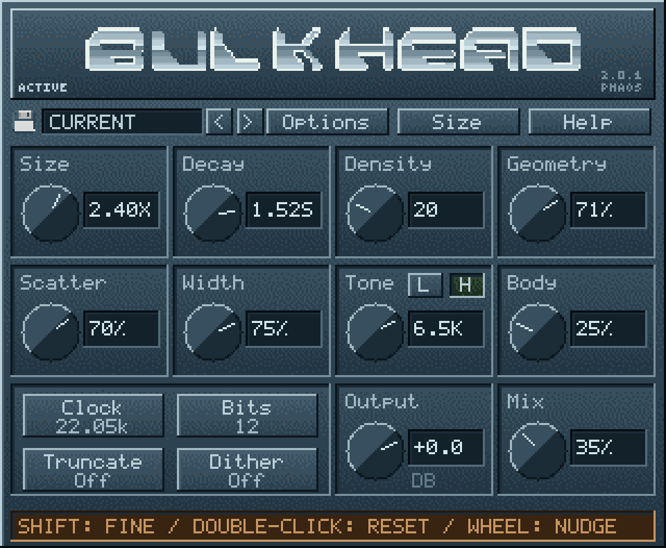

[](https://ko-fi.com/phaos)

# Bulkhead

Bulkhead is a Windows x64 VST3 reverb by Phaos. It combines a finite
signed reflection-packet engine with Sound Blaster Pro II ADC/DAC audio-path
emulation: clocked unsigned 8-bit PCM conversion, held samples, and selectable
input and output filters.

Version 2.0.1 uses one fixed captured-dry signal path and one shared mono wet
history with balanced stereo packet output. Normal operation is nominal
22.05 kHz stereo, 20 packets and no dither; nominal 11.025 kHz is the
economy/extreme setting. This version intentionally sounds different from 1.x.
It has separate VST3 IDs, the host name **Bulkhead**, and the bundle
`Bulkhead.vst3`, so version 1 can remain installed in a separate version subfolder.
There are no legacy routing modes or version 1 session migrations.
Version 2.0.0 sessions remain valid in 2.0.1.

The reverb runs between the input and output conversion stages. Its selectable
8-, 12-, and 16-bit internal precision is separate from the 8-bit converters.



## Download

**[Download Bulkhead 2.0.1 for Windows x64](https://github.com/Phaos2000/Bulkhead/releases/download/v2.0.1/Bulkhead-2.0.1-Windows10-x64.zip)**

Extract the ZIP and copy the complete `Bulkhead.vst3` folder to your host's
VST3 directory, then rescan. Your host lists it as **Bulkhead**, version 2.0.1.
Replace the earlier 2.0.0 bundle (`Bulkhead2.vst3`) rather than installing both
version 2 bundles: they share the same plugin ID. To keep version 1 alongside
version 2, place their complete bundles in separate version subfolders within
your VST3 directory; both bundles are named `Bulkhead.vst3`.

[Original Bulkhead 1.0.1](https://github.com/Phaos2000/Bulkhead/releases/tag/v1.0.1)
remains available for the original sound. Both plugins can stay installed.
Version 2 intentionally changes the sound and does not import version 1 sessions
or presets.

[Release and checksums](https://github.com/Phaos2000/Bulkhead/releases/tag/v2.0.1) �
[Complete source checkpoint](https://github.com/Phaos2000/Bulkhead/releases/download/v2.0.1/Bulkhead-2.0.1-source-checkpoint.zip) �
[Validation checkpoint](docs/2.0.1-CHECKPOINT.md) �
[Authenticity audit](docs/AUTHENTICITY-AUDIT.md)

This Windows build passed all five automated test suites and all 47 VST3
validator tests. DAW listening acceptance remains open. DOS development is paused;
real-time performance on a 486 has not been proved.

See the [changelog](CHANGELOG.md) for version changes and validation results.

## Signal path

```text
Host input -> optional input low-pass -> clocked unsigned 8-bit stereo ADC
                                           |                  |
                                           |       mono wet history
                                           |       signed packets / stereo pan
                                           |       Body -> Output -> Mix
                                           +------------------+
                                           summed captured dry + wet
                                           -> one 8-bit stereo DAC
                                           -> hold -> output filter -> host output
```

Mix adds reverb to fixed-level captured dry before the final DAC. At 0%, audio
still passes through both converters and their selected filters. The final DAC
can clip the dry/wet sum at its 8-bit rails. Output changes wet level only.
Full host bypass returns the original input.

## Converter emulation

| Stage | Implementation |
|---|---|
| Input conversion | Unsigned 8-bit linear PCM; centred at code 128; saturation at the converter limits |
| Input filter | Off, 3.2 kHz, or 8.8 kHz low-pass; two-pole Butterworth approximation at host sample rate |
| Nominal clock choices | 11.025 kHz and 22.05 kHz |
| Implemented stereo clock rates | 11,111 Hz and 21,739 Hz, derived from integer DSP time-constant divisors |
| Clock changes | Phase-continuous 8 ms ramp; stored reflections change pitch and duration with the clock |
| Output conversion | Unsigned 8-bit linear PCM, independent of internal chamber precision |
| Playback hold | 45,454 Hz converter update grid |
| Output filter | Optional two-pole 3.2 kHz low-pass after the playback hold |
| Dither | Optional TPDF at ADC capture, internal quantization, and final DAC conversion; digital idle silence remains zero |

The scope is the card's audio path. Analogue filter responses are approximated;
the implementation has not been established as a component-level or measured
match to a particular physical card. ISA registers, DMA, interrupts, FM
synthesis, and ADPCM are outside its scope.

The physical Sound Blaster Pro II did not run this reverb and was half-duplex.
Bulkhead uses the modern host's simultaneous input/output to place a software
reverb between the two conversion stages. This continuous live effects chain
is an extension of the hardware workflow. See [DOS-DESIGN.md](DOS-DESIGN.md).

The converter behaviour is informed by Creative's
[Hardware Programming Guide](https://ardent-tool.com/sound/Sound_Blaster_HW_Programming_Guide_1st.pdf)
and the [DOSBox Staging audio-path reference](https://github.com/dosbox-staging/dosbox-staging/blob/c50a9b4c7b09f3cbd3153c3f95afc736134a6dba/src/hardware/audio/soundblaster.cpp).

## Reverb design

- Finite feed-forward cloud of three-fragment signed packets; 16-24 is the
  normal design target, 20 the default, and 4-64 remains available. The upper
  end is experimental for a 486 budget.
- One 131,072-word signed 16-bit ring is allocated: 256 KiB of wet history.
- Q15 reflection coefficients and bounded 32-bit products and accumulation.
  Host I/O, converter filter calculations, parameter smoothing, and parts of
  control generation use floating point.
- Geometry changes packet clustering and fragment weights/spacing; Scatter
  changes timing irregularity and polarity. Changed layouts crossfade over
  18 ms using stationary read positions.
- The chamber averages the stereo ADC captures, then applies deterministic
  equal-power packet panning for stereo Width. Opposite-polarity inputs can
  cancel.
- The chamber combines fragment, packet and pan gains at control rate, removing
  the separate packet-gain multiply and intermediate packet quantization/clipping.
  This intentionally changes the wet sound.
- Body applies wet-only low-mid shaping and bounded soft limiting before
  the final DAC conversion.
- The reflection engine uses no recirculating comb/all-pass network, feedback
  delay network, or FFT convolution. It is not based on a named historical reverb.

The arithmetic and memory budget draw on a DOS-era processing design. The
plugin is a modern C++ implementation; real-time operation on a 486 has not
been verified.
The 16-24 packet range remains a Windows design target, not an established
DX2/66 budget. See the [authenticity audit](docs/AUTHENTICITY-AUDIT.md) for the
hardware contract, modern conveniences and current limits.

## Controls

| Control | Range or function |
|---|---|
| Size | 0.05-32x reflection geometry scale |
| Decay | 0.025-4 s at the 22.05 kHz reference; readout follows the actual selected clock |
| Density | 4-64 packets; normal target 16-24, default 20 |
| Geometry | Packet clustering and fragment shape |
| Scatter | Reflection timing irregularity, fragment spacing, and polarity |
| Tone L | Wet-path low cutoff, 0-2,000 Hz; 0 is Off |
| Tone H | Wet-path high cutoff, 350-20,000 Hz, limited by the processing rate |
| Width | Stereo packet panning, 0-100% |
| Body | Wet-path low-mid shaping and soft limiting, 0-100% |
| Output | Wet-only gain, -36 to +12 dB |
| Mix | Added reverb amount, 0-100%; captured dry level stays fixed |
| Clock | Nominal 22.05 kHz normal / 11.025 kHz economy-extreme |
| Bits | 8 / 12 / 16-bit internal processing precision |
| T | Truncate fixed-point products and coarsen control coefficients |
| D | Enable dither |
| Input filter | Off / 3.2 kHz / 8.8 kHz |
| Output filter | Off / 3.2 kHz |
| Title button | Full bypass |

## Host and interface

- Windows x64, VST3, matching mono or stereo input/output buses.
- 32- and 64-bit floating-point host buffers; host sample rates 8-384 kHz.
- Zero reported buffering latency; reflection delays, filtering, and converter
  timing still affect the signal. Reported tail length is 13 seconds.
- Native 320x263 pixel interface, fixed 32-colour palette, nearest-neighbour
  scaling, and error-diffused textures. GUI updates and mouse-drag commits are
  capped at 25 Hz; audio and host automation are processed independently.
- Interface scales: 1.5x, 2x, 3x, 4x, and 5x, with host DPI handling.
- One custom arrow cursor with four colour choices, plus the system cursor.
- INIT and five factory presets; user preset load/save/update/rename/delete.

The current Windows candidate includes the weighted stereo-balance correction
and settled-parameter/filter optimizations. The separate DOS feasibility study is
paused and is not part of the VST3 audio engine. Its build targets are disabled
by default; no DOS toolchain is required to build or use the Windows plugin.

User presets are stored in `%APPDATA%/Bulkhead2/Presets`. Size and cursor
preferences also have fallbacks under `%APPDATA%/Bulkhead2`.

## Build from source

Install Git, CMake 3.25 or newer, and Visual Studio with the Desktop development
with C++ workload. In PowerShell, from the repository root:

```powershell
powershell -NoProfile -ExecutionPolicy Bypass -File tools/fetch-sdk.ps1
cmake -S . -B build-win -G "Visual Studio 18 2026" -A x64
cmake --build build-win --config Release --target Bulkhead bulkhead_tests bulkhead_direction_tests bulkhead_preset_tests bulkhead_host_tests bulkhead_preview bulkhead_integration validator
ctest --test-dir build-win -C Release --output-on-failure
```

Use the matching generator for another supported Visual Studio version.
The setup script fetches the official VST3 SDK at `v3.8.1_build_84`, commit
`3cdf9ca5d1f5b1b21e0a86832aa4abe55607bd96`, with the base, cmake,
pluginterfaces, and public.sdk submodules. VSTGUI is not required.

The plugin bundle is produced at `build-win/VST3/Release/Bulkhead.vst3/`.
Copy the entire bundle to your host's VST3 search directory, commonly
`C:/Program Files/Common Files/VST3`, and rescan.

Tests write diagnostic logs/audio and temporary presets under `artifacts/`.
The diagnostic audio is generated from synthetic excitation. It is not a
collection of sampled instruments or commercial recordings.

The `bulkhead_integration` test compares the actual compiled plugin with the
source engine across mono/stereo, 32/64-bit buffers, sample rates, automation,
and silence flags. An optional second binary argument loads an original plugin
alongside version 2 and checks that processor IDs differ. This is not a test
of identical sound between versions.

This repository contains source code. Historical archives, local build files,
and downloaded reference artwork are excluded. Before redistributing a build,
include `LICENSE`, `THIRD_PARTY_NOTICES.md`, and `LICENSES/` with the plugin.

## License and attribution

Copyright (c) 2026 Phaos - phaos2000@pm.me.

Bulkhead uses the custom [Bulkhead Freeware and Source-Available License](LICENSE).
Free use includes commercial music, recordings, performances, and paid audio
production. No royalties or credits in musical output are required.

Redistribution must preserve attribution and license notices. Distributed
modifications must include complete corresponding source under the same terms,
identify changes, and be marked unofficial. Before releasing a modified version,
email phaos2000@pm.me with a description and source location; a reply is not required.
Selling the plugin, paid bundles/services containing it, or commercial code
reuse requires separate written permission. The full license controls.

Dependencies and embedded artwork have separate terms. The title font and
cursor artwork have unresolved redistribution permissions, documented in
[THIRD_PARTY_NOTICES.md](THIRD_PARTY_NOTICES.md). The custom license grants no
additional rights to those materials.

VST is a registered trademark of Steinberg Media Technologies GmbH.
Sound Blaster and Sound Blaster Pro are trademarks of Creative Technology Ltd.
Bulkhead is an independent project and is not endorsed by either company.
